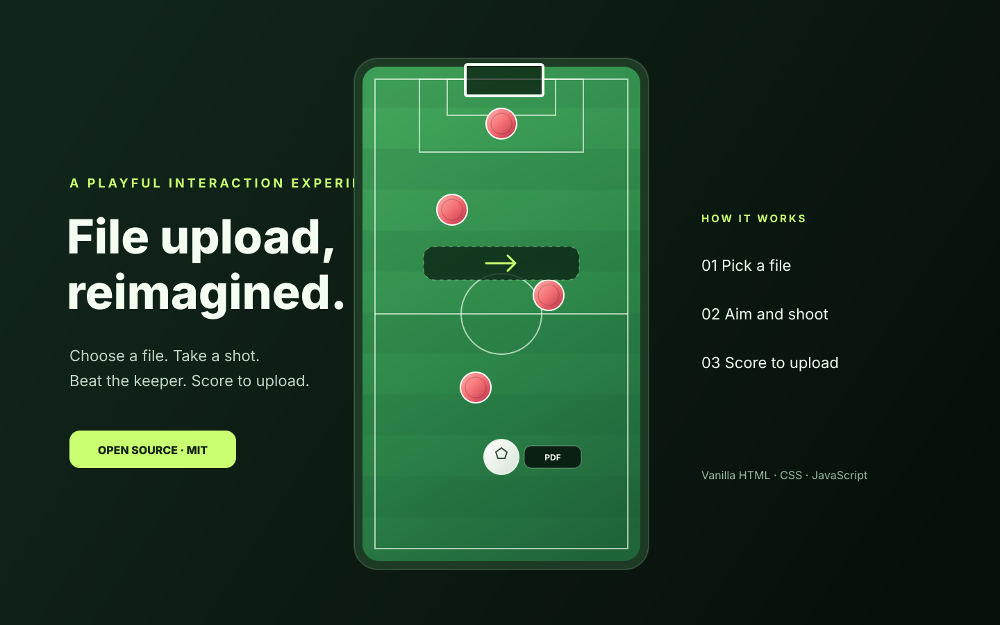

<div align="center">
  
  <h1>Football-Inspired File Upload</h1>
  <p><strong>Pick a file. Take the shot. Beat the keeper. Score to upload.</strong></p>
  <p>A playful, framework-free experiment that turns a familiar dropzone into a top-down mini football game.</p>
  <p>
    <a href="https://github.com/ariantaheri/football-file-upload/actions/workflows/ci.yml"></a>
    <a href="https://github.com/ariantaheri/football-file-upload/actions/workflows/codeql.yml"></a>
    <a href="LICENSE"></a>
    <a href="https://developer.mozilla.org/en-US/docs/Web/JavaScript"></a>
    <a href="https://github.com/ariantaheri/football-file-upload/stargazers"></a>
  </p>
</div>

---

## Why this exists

Traditional file uploaders are functional, but rarely memorable. This experiment explores a simple idea: what if the selected file became the ball in a tiny football game?

The user picks or drops a file onto the field, drags it backwards to aim, and releases to shoot. Red defenders and a moving goalkeeper try to stop it. A goal completes the interaction.

## Features

- **Top-down football field** with a table-soccer-inspired layout.
- **The file is the ball:** the selected file is represented on the pitch, including its extension and image preview when available.
- **Drag-to-aim shooting** with pointer, mouse, and touch input.
- **Moving defenders and goalkeeper** with circle collision response.
- **Responsive canvas** designed for desktop and mobile screens.
- **File picker and drag-and-drop** support.
- **Optional real upload API** using `multipart/form-data`.
- **Keyboard fallback** for taking a shot.
- **No front-end framework** and no front-end runtime dependencies.
- **GitHub Actions** for quality checks, CodeQL analysis, and GitHub Pages deployment.

## Try it locally

Requirements: **Node.js 20 or newer**. No `npm install` is needed for the front-end demo.

```bash
git clone https://github.com/ariantaheri/football-file-upload.git
cd football-file-upload
npm run dev
```

Open **http://127.0.0.1:4173** in your browser.

The built-in development server uses Node.js core modules and only serves the app shell and required front-end assets. Alternatively, run any static web server from the repository root.

## How to play

1. Select a file with **Choose File**, or drag a file onto the pitch.
2. Press the file token and drag backwards to aim and set shot power.
3. Release to shoot.
4. Get the file past the defenders and goalkeeper and into the goal.
5. Select **Upload Another File** to play again.

On touch devices, use the same press-and-drag gesture. With a file selected, focus the field and press **Enter** or **Space** to take a basic keyboard shot.

## Demo mode and real uploads

> **Important:** The default configuration is a visual demo. Scoring a goal shows the success state, but the file is not transmitted or stored. Do not treat the demo success state as proof of server-side storage.

To perform a real upload, configure an endpoint you control in `src/config.js`:

```js
window.FILE_UPLOAD_CONFIG = Object.freeze({
  uploadEndpoint: '/api/upload',
  maxFileSizeBytes: 25 * 1024 * 1024,
  uploadTimeoutMs: 60_000
});
```

After a goal, the client sends a `POST` request containing a `FormData` field named `file`. The UI shows success only after the configured endpoint responds with a `2xx` status.

### API contract

| Item | Value |
| --- | --- |
| Method | `POST` |
| Content type | `multipart/form-data` |
| File field | `file` |
| Success | Any `2xx` response |
| Failure | Non-`2xx`, network error, or timeout |

Do not manually set the multipart `Content-Type` header. The browser must add its boundary.

See [the API contract](docs/upload-api.md) for the request and response details.

### Optional Express example

A small local API is included in `examples/server`. It uses Express and Multer, generates a random storage filename, applies a file-size limit, stores uploads outside the public static paths, and automatically configures the client to use the local API. A Dockerfile is also provided for a containerized full-stack preview.

```bash
cd examples/server
npm install
npm start
```

Open **http://localhost:3000**. The example server injects the `/api/upload` endpoint configuration automatically, so this local setup performs a real upload to its private `uploads` directory.

The example and Docker image are for local integration and evaluation, **not a production-ready upload service**. Before exposing it publicly, add authentication and authorization, rate limiting, file-signature/content validation, malware scanning where appropriate, storage quotas, retention and deletion rules, monitoring, and a production storage backend. Read [SECURITY.md](SECURITY.md) before accepting untrusted files.

## Configuration

Edit `src/config.js`:

| Option | Default | Description |
| --- | --- | --- |
| `uploadEndpoint` | `''` | Empty string keeps demo mode. Set a URL or path for real uploads. |
| `maxFileSizeBytes` | `25 * 1024 * 1024` | Client-side size limit. The server must enforce its own limit. |
| `uploadTimeoutMs` | `60_000` | Maximum time to wait for the upload request. |

## Project structure

```text
.
├── .github/
│   ├── ISSUE_TEMPLATE/       # Structured bug reports and feature requests
│   ├── workflows/            # CI, CodeQL, and GitHub Pages deployment
│   └── dependabot.yml        # Dependency and Actions update checks
├── assets/
│   ├── preview.svg           # README project preview
│   └── social-preview.svg    # GitHub social preview image
├── docs/                     # API, deployment, metadata, and roadmap docs
├── examples/server/          # Optional Express + Multer upload API
├── scripts/                  # Development server, checks, and Windows publisher
├── src/                      # Game logic, styles, and upload configuration
├── Dockerfile
├── CITATION.cff
├── CODE_OF_CONDUCT.md
├── CONTRIBUTING.md
├── LICENSE
├── SECURITY.md
└── index.html
```

## Quality checks

Run the repository checks locally:

```bash
npm run check
```

GitHub Actions runs the same checks on pushes and pull requests. A separate CodeQL workflow analyzes the JavaScript code for security issues, and Dependabot checks the optional server dependencies and GitHub Actions for updates.

## Deploy the demo

The repository includes a GitHub Pages workflow at `.github/workflows/pages.yml`.

1. Push the repository to the `main` branch.
2. In GitHub, open **Settings → Pages**.
3. Set the publishing source to **GitHub Actions**.
4. Manually run **Deploy demo to GitHub Pages** in the Actions tab after enabling Pages. This workflow is manual so regular checks stay green while Pages is not enabled.

GitHub Pages hosts only the static demo. It does not provide an upload backend. Deploy an API separately and configure `uploadEndpoint` when real file storage is required. More details are in [Deployment](docs/deployment.md).

## Privacy

- In demo mode, the selected file stays in the browser and is not sent by this project.
- When an upload endpoint is configured, the selected file is sent to that endpoint after a goal is scored.
- This project does not include analytics, advertising, or third-party tracking code.
- The operator of the upload endpoint is responsible for its privacy notice, access controls, retention, and deletion practices.

## Roadmap

Possible next steps include customizable game physics and field themes, stronger keyboard accessibility, browser-level tests, and additional storage integrations. See the [roadmap](docs/roadmap.md) and open a feature request to discuss an idea.

## Contributing

Contributions are welcome: bug fixes, gameplay improvements, accessibility enhancements, documentation updates, and new integrations.

Please read [CONTRIBUTING.md](CONTRIBUTING.md) before opening an issue or pull request. Bug reports and feature requests can be submitted through the repository's issue templates.

## License

Released under the [MIT License](LICENSE). You are free to use, modify, and distribute this project under its terms.

## Credits

Created by [Arian Taheri](https://github.com/ariantaheri).

If you use this project in academic or technical work, see [CITATION.cff](CITATION.cff).
